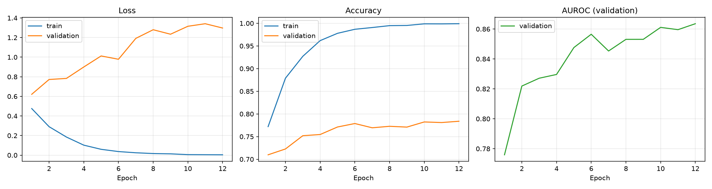
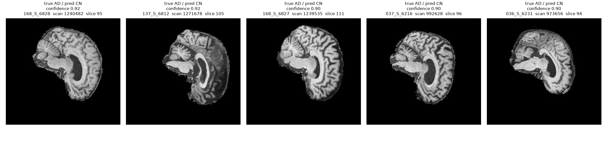

# ConvNeXt for Alzheimer's (AD vs CN) Classification on ADNI

> COMP3710 Pattern Recognition Report — Project 2.1 (Classification), **ConvNeXt [Hard Difficulty]**
> Author: s4980060 · Branch: `topic-recognition`


## Table of Contents
1. [Problem Description](#1-problem-description)
2. [How ConvNeXt Works](#2-how-convnext-works)
3. [Feasibility Review](#3-feasibility-review)
4. [Results](#4-results)
5. [Resource Profiling](#5-resource-profiling)
6. [Triage Policy and Failure Autopsy](#6-triage-policy-and-failure-autopsy)
7. [Engineering Recommendation](#7-engineering-recommendation)
8. [Reproducing the Results](#8-reproducing-the-results)
9. [Repository Structure](#9-repository-structure)
10. [References](#10-references)
11. [Artificial Intelligence Usage Disclosure](#11-artificial-intelligence-usage-disclosure)

---

## 1. Problem Description

Alzheimer's Disease (AD) causes irreversible neurodegeneration, visible on structural T1-weighted MRI as
hippocampal and cortical atrophy and ventricular enlargement. This project builds an automated classifier
that labels 2D brain MRI slices from the ADNI dataset as **AD** or **Cognitively Normal (CN)**, intended as a
triage assistant: confident predictions are automated, while uncertain ones are routed to a specialist.
The target is **≥ 0.8 test accuracy** on a patient-disjoint test set, but the main question is whether the
model's confidence can be trusted.

## 2. How ConvNeXt Works

ConvNeXt (Liu et al., 2022) is a pure convolutional network "modernised" with design choices borrowed from
Vision Transformers:

- **Patchify stem:** a 4×4 convolution with stride 4 replaces the ResNet 7×7 conv + max-pool stem.
- **Stage layout:** four stages with block ratio 3:3:9:3 (ConvNeXt-T), with downsampling layers
  (LayerNorm + 2×2 stride-2 conv) between stages.
- **ConvNeXt block:** 7×7 depthwise conv → LayerNorm → 1×1 conv expanding channels 4× → GELU →
  1×1 conv projecting back, with a residual connection, layer scale and stochastic depth (drop path).
- **Fewer normalisation/activation layers** than ResNet, and LayerNorm instead of BatchNorm.


The large depthwise kernel gives a wide receptive field (similar in spirit to attention windows) while keeping
the inductive biases of convolutions, which matters for a small medical dataset.

The 32× total downsampling is worth noting now because it becomes a hypothesis later: a 224×224 slice is
reduced to a 7×7 feature map, against 28×28 for the baseline CNN, which plausibly discards the fine-scale
atrophy AD is read from. §4.1 tests and rejects that explanation.

## 3. Feasibility Review


### 3.1 User Need, Scope and Acceptance Criteria

This prototype is for a doctor or screening reviewer who needs brain MRI scans sorted into Alzheimer's (AD)
or healthy (CN), with any scan the model is unsure about sent to a specialist. It labels 2D brain slices and
also reports how sure it is, and that confidence number has to be trustworthy. The project asks two questions:
when the model says it is confident, is it actually right, and is ConvNeXt accurate enough to justify its extra
cost compared with a simple CNN?

**Acceptance criteria** (all measured on a patient-disjoint test set):

| # | Criterion | Target |
|---|-----------|--------|
| 1 | Accuracy | Test accuracy ≥ 0.80 for AD vs CN |
| 2 | Calibration | Expected Calibration Error (ECE) ≤ 0.10 after calibration, and lower than the baseline's ECE |
| 3 | Resources | Peak training VRAM ≤ 16 GB and one training run ≤ 2 h on a single GPU |

### 3.2 Model Choice and Course Concepts

I use ADNI brain MRI slices labelled AD or CN, split by patient so no person appears in both training and test
data. The main model is ConvNeXt (Hard difficulty), compared against a simple CNN baseline on the exact same
split. ConvNeXt is a modern CNN that builds on our course lab material and suits small medical datasets, and it
matches newer transformer models in accuracy at a similar cost. I judge both models on accuracy, precision,
recall, F1, AUROC, and calibration (ECE), which shows whether the model's confidence matches how often it is
right.

### 3.3 Preliminary Feasibility Evidence

**Data audit.** The dataset contains **30,520 image slices** (14,860 AD and 15,660 CN), drawn from
**1,526 scans** (743 AD and 783 CN) at exactly 20 slices per scan, belonging to **680 unique patients**.

The patient identifier is *not* the number in the filename: `218391_78.jpeg` identifies a scan, and one
patient may be scanned at several visits. Real ADNI subject ids (e.g. `068_S_0473`) are recovered from
`meta_data_with_label.json`, which maps each scan to the raw NIfTI it came from. Resolving them matters,
because the class balance looks very different at the two levels:

| Level | AD | CN | Balance |
|-------|----|----|---------|
| Slices | 14,860 | 15,660 | 49 / 51 |
| Patients | 221 | 459 | 32 / 68 |

The slice-level balance is an artefact: AD patients average 3.36 scans each against 1.71 for CN, so the two
classes even out only after a patient is counted once per scan. Training operates on slices and is therefore
effectively balanced, but **any patient-level metric faces a 68% majority-class baseline** — predicting CN
for everyone would score 0.68. Per-class recall, macro-F1 and AUROC are reported for this reason, rather than
aggregate accuracy alone.

**Key finding:** once real subject ids are resolved, the dataset's provided `train` and `test` folders
**share 216 of the same patients**, which would make test results look better than they really are. (Judged by
the scan number in the filename the folders appear perfectly disjoint, which is exactly why the leakage is easy
to miss.) So I combine all the images and split them again by patient (70% train, 15% validation, 15% test,
stratified so each split keeps a similar AD/CN mix), then assert that no patient appears in more than one set.

**Smoke test (RTX 4070 laptop GPU).** The rebuilt split assigns all 680 patients as train 476 / val 102 /
test 102 (21,560 / 4,580 / 4,380 slices) with zero overlap, and no patient carries both labels. Folder-derived
labels were additionally cross-checked against the diagnostic code in `meta_data_with_label.json`: all 1,526
scans agree.

Every count in this section is produced by `python dataset.py --audit --root <path>/AD_NC` and saved to
[outputs/split_audit.json](outputs/split_audit.json), including the 216 overlapping subject ids by name, so
the leakage claim can be checked rather than taken on trust.

| Model | Parameters | Measurement | Result |
|-------|-----------|-------------|--------|
| Tiny baseline CNN | 0.02M | ~8 s/epoch, 0.29 GB GPU memory | Still predicted a single class after 2 epochs (val acc 0.51) → needs input normalisation and longer training |
| ConvNeXt-Tiny | 27.8M | 3.67 GB GPU memory for one training step, batch 32, 224 px | Fits comfortably on available GPUs |

### 3.4 Risks, Budget and Fallback

- **Risks:** The given train and test folders share some of the same patients, so I make my own split by
  patient. Accuracy will likely be lower, but it will be honest. The model may also be very confident even when
  it is wrong on unclear scans, which is the main question this project investigates. Because the dataset is
  small, the model may memorise instead of learning, so I use augmentation such as flips and small rotations,
  plus other regularisation. Finally, Rangpur's GPUs are shared, so jobs may wait in the queue.
- **Budget** (initial estimate, to be updated after the first full training run): about 15 hours of GPU time —
  ~1 h for the baseline, ~10 h for ConvNeXt, ~2 h for analysis, and spare time for reruns. Short interactive
  sessions for testing and batch jobs for long training.
- **Next experiment:** train the simple CNN on the patient split, then train ConvNeXt on the same split, and
  compare their accuracy and how honest their confidence is.
- **Fallback:** if ConvNeXt doesn't reach 0.8 accuracy, try a smaller ConvNeXt with more augmentation. If it is
  still short, report the real result and explain why.

## 4. Results

Every run shares seed 42 and therefore the identical patient-level split (476 / 102 / 102 patients). The
best epoch within a run is chosen by **validation AUROC**, not accuracy, because the patient-level class mix
is 32 / 68 and accuracy would favour a model that simply leans towards CN.

| Model | Params | Recipe | Val AUROC | Slice acc | Slice AUROC | Patient acc | Slice AD recall | ECE (cal.) |
|-------|--------|--------|-----------|-----------|-------------|-------------|-----------|------------|
| Baseline CNN | 0.02M | 30 ep, lr 3e-4 | 0.7468 | 0.7970 | 0.8696 | 0.8039 | 0.7134 | 0.1144 |
| ConvNeXt-T (scratch) | 27.8M | 30 ep, lr 3e-4 | 0.6997 | 0.6811 | 0.7572 | 0.6961 | 0.7289 | 0.0372 |
| ConvNeXt-mini (scratch) | 4.8M | 30 ep, lr 3e-4 | 0.7015 | 0.6897 | 0.7561 | 0.7353 | 0.7036 | 0.0397 |
| **ConvNeXt-T (ImageNet)** | 27.8M | 12 ep, lr 5e-5 | **0.8635** | **0.8295** | 0.9091 | 0.8725 | 0.7995 | **0.0387** |
| ConvNeXt-T (ImageNet) | 27.8M | 20 ep, lr 5e-5 | 0.8602 | 0.8441 | 0.9250 | 0.8824 | 0.8454 | 0.0486 |

Majority-class baseline (predict CN for every patient): **0.6765**.

The bold row is the reported model. It is selected on **validation** AUROC, so the 20-epoch run is not
chosen despite scoring higher on every test metric — §4.3 explains why that restraint matters.

**Acceptance criteria.** All three are met by the pretrained ConvNeXt: slice accuracy 0.8295 ≥ 0.80
(criterion 1); slice ECE 0.0387 ≤ 0.10 and below the baseline's 0.1144 (criterion 2); peak VRAM 4.10 GB
≤ 16 GB and 54.8 min ≤ 2 h (criterion 3). Criterion 2 is met at slice level; patient-level ECE is 0.0983,
inside the threshold but much closer to it. Averaging a patient's slice probabilities (`aggregate_by_patient`
in [predict.py](predict.py)) sharpens confidence without making it proportionally more accurate, because the
20 slices of one scan are not 20 independent observations.



*Loss and metrics per epoch for the reported model. The training/validation separation visible here is the
overfitting quantified in §4.1.*

### 4.1 Initialisation, not architecture, was the bottleneck

The scratch and 12-epoch ImageNet rows above are the *same 27.82M-parameter network* — identical code,
identical split, identical augmentation, identical 12-epoch best. Only the starting weights differ, and that
alone moves slice accuracy from 0.6811 to 0.8295. (Both runs happen to select epoch 12 on validation, so
even the training length is matched.) From scratch the network barely clears the majority-class baseline;
fine-tuned from ImageNet it is the only configuration that meets the accuracy target.

The epoch-1 validation accuracies make the mechanism plain: 0.7098 fine-tuned, against 0.5648 for
ConvNeXt-T and 0.5485 for ConvNeXt-mini from scratch — barely above chance. 21,560 training slices are not enough to learn 27.8M parameters from random initialisation, but they
are ample for adapting features already learned elsewhere — even though those features come from natural
colour photographs and these are single-channel brain MRI. The ImageNet stem is adapted to one channel by
summing its three input filters, and the classifier head is the only part trained from scratch
(180 / 180 pretrained tensors loaded; see `load_imagenet_weights` in [modules.py](modules.py)).

Two intermediate hypotheses were tested and rejected along the way.

**Overfitting.** The from-scratch network memorises: training accuracy 0.9946 against validation 0.6376, a
36 pp gap. Shrinking it to 4.8M parameters and raising stochastic depth to 0.2 barely moves that, and
accuracy does not move either — compared at matching points rather than cherry-picked ones:

| | ConvNeXt-T | ConvNeXt-mini | |
|---|---|---|---|
| Gap at the selected epoch | 27.5 pp | 25.7 pp | −1.8 pp |
| Gap at the final epoch | 35.7 pp | 33.7 pp | −2.0 pp |
| Test slice accuracy | 0.6811 | 0.6897 | +0.9 pp |

A 5.8× reduction in parameters bought a 2 pp reduction in the gap. Regularisation did not meaningfully
reduce the overfitting, and the accuracy it was meant to unlock never appeared, so capacity was not the
limiting factor. (An earlier 15-epoch variant with heavier
augmentation — random resized crop, ±15° rotation, colour jitter — narrowed the gap further still and scored
0.6776, lower again; its artefacts were overwritten by the run reported here, so only its test accuracy is
quoted.)

**The patchify stem.** ConvNeXt downsamples 32× in total, to a 7×7 final feature map, against 8× and 28×28
for the baseline, which plausibly discards the fine-scale atrophy that AD is read from. The pretrained model
refutes this directly: same 4×4 stride-4 stem, same 7×7 map, 0.8295.

### 4.2 Calibration

Temperature scaling (Guo et al., 2017), fitted on validation only, never changes a prediction — it rescales
the logits — so accuracy, F1 and AUROC are identical before and after. It changes only whether the reported
confidence can be believed.

| Model | Temperature | Test ECE before | Test ECE after |
|-------|-------------|-----------------|----------------|
| ConvNeXt-T (ImageNet, 12 ep) | 5.62 | 0.1430 | 0.0387 |
| ConvNeXt-T (ImageNet, 20 ep) | 5.63 | 0.1295 | 0.0486 |
| ConvNeXt-T (scratch) | 5.17 | 0.2133 | 0.0372 |
| ConvNeXt-mini (scratch) | 4.41 | 0.1764 | 0.0397 |
| Baseline CNN | 2.09 | 0.0162 | **0.1144** |

**The fitted temperature orders the models exactly by how hard they memorised the training set:**

| Model | Final train acc | Temperature |
|-------|-----------------|-------------|
| ConvNeXt-T (ImageNet) | 0.9990 | 5.62 |
| ConvNeXt-T (scratch) | 0.9946 | 5.17 |
| ConvNeXt-mini (scratch) | 0.9671 | 4.41 |
| Baseline CNN | 0.8096 | 2.09 |

The relationship is monotonic across a 1,176× range of model size. A network that reaches 99.9% training
accuracy has learned that extreme confidence is always rewarded, because on the data it memorised it almost
always is; the temperature is the correction that fact demands. The 0.02M baseline cannot memorise 21,560
slices, is never rewarded for overconfidence, and needs little correction.

Note also that every ConvNeXt variant lands at ECE 0.037–0.049 after scaling, whether its accuracy is 0.69 or
0.84. Calibration quality and discrimination are separate properties: a model can be reliably wrong.

The baseline is the instructive case: its uncalibrated ECE was already 0.0162, and calibration made it
**seven times worse**. A temperature fitted on validation only transfers to test when the two distributions
of confidence agree, and for the baseline they did not. Calibration is therefore not a free post-processing
step — it has to be validated on held-out data like any other model choice, and an already well-calibrated
model should be left alone.


*Reported model, test set, after calibration. The baseline's equivalent is
[assets/baseline_reliability.png](assets/baseline_reliability.png), where the bars sit well below the
diagonal — the visual form of its 0.1144 ECE.*

### 4.3 Run-to-run variance, and selecting without the test set

Training the same configuration for 20 epochs instead of 12 produced a model that is better on every test
metric — slice accuracy 0.8441, AUROC 0.9250, AD recall 0.8454 against 0.7995, which is 89 fewer missed AD
slices. It is nonetheless *not* the reported model, because **validation AUROC prefers the 12-epoch run**
(0.8635 against 0.8602).

Reporting the 20-epoch run would mean choosing a hyperparameter by its test score, which is the same class of
mistake as the patient leakage this project exists to document: it turns the test set into a selection set and
the quoted accuracy stops being an estimate of unseen performance. The 12-epoch run is therefore reported,
and the 20-epoch run is listed for comparison rather than promoted.

The comparison is informative in its own right. Both runs are bit-identical for their first three epochs —
seed 42 fixes the data order, the head initialisation and the augmentation — and diverge from epoch 4 only
because the cosine learning-rate schedule is stretched over 20 epochs instead of 12. Both then select epoch
12 by validation AUROC. The 1.5 pp gap in test accuracy comes entirely from that difference in schedule
shape, which is **the same order of magnitude as the gap between distinct configurations**. Any single
accuracy figure quoted for this dataset therefore carries roughly ±1.5 pp of run-to-run noise, and
differences smaller than that should not be read as evidence.

The exercise also corrected a wrong diagnosis. The 12-epoch run selected its final epoch with validation
AUROC still climbing (0.8611 → 0.8635), which looked like premature stopping. Extending the schedule showed
otherwise: validation AUROC peaks at epoch 12 in both runs and then plateaus. The late climb was the cosine
schedule annealing to zero, not a model still learning.

### 4.4 Preprocessing and training details

Not stated elsewhere, and needed to reproduce the numbers above.

**Preprocessing.** Slices are loaded as single-channel greyscale, resized to 224×224, and normalised with
mean 0.1159 and standard deviation 0.2227. Both statistics are computed **on the training split only**
(`compute_channel_stats` in [dataset.py](dataset.py)); using the whole dataset would leak test-set
information into the input scaling. Training augmentation is a horizontal flip at p = 0.5 and a rotation of
up to ±10° (`--augment light`); validation and test apply the resize and normalisation alone.

**Optimisation.** AdamW, weight decay 0.05, cross-entropy without label smoothing, batch size 32. The
learning rate warms up linearly for 2 epochs and then follows a cosine decay to zero over the remaining
epochs — which is why the 12-epoch and 20-epoch runs of §4.3 diverge despite sharing a seed.

**No early stopping.** Every run trains its full epoch budget; the reported model is the epoch with the best
validation AUROC, restored from the checkpoint at the end. This separates "when to stop training" from "which
weights to keep" and costs only compute.

## 5. Resource Profiling

Measured on one RTX 4070 laptop GPU (8 GB), batch 32, 224 px, FP32. Latency is the mean of 30 forward passes
after 5 discarded warm-up passes, with `torch.cuda.synchronize()` around the timed region; it is measured by
`measure_latency` in [predict.py](predict.py) and stored in each `outputs/{model}_evaluation.json`, so the
figures below are read back from file rather than quoted from a one-off benchmark.

| Model | Params | Peak train VRAM | Train time | Inference | Slice acc |
|-------|--------|-----------------|------------|-----------|-----------|
| Baseline CNN | 0.02M | 0.55 GB | 13.8 min (30 ep) | 0.36 ms/slice | 0.7970 |
| ConvNeXt-mini | 4.8M | 1.40 GB | 37.0 min (30 ep) | 0.75 ms/slice | 0.6897 |
| ConvNeXt-T (scratch) | 27.8M | 4.10 GB | 149.4 min (30 ep) | 2.71 ms/slice | 0.6811 |
| ConvNeXt-T (ImageNet) | 27.8M | 4.10 GB | **54.8 min (12 ep)** | 2.64 ms/slice | **0.8295** |
| ConvNeXt-T (ImageNet) | 27.8M | 4.10 GB | 84.5 min (20 ep) | 2.70 ms/slice | 0.8441 |

ConvNeXt-T costs 1,176× the parameters and about 7.4× the inference time of the baseline to buy 3.3 pp of
slice accuracy and 6.9 pp of patient accuracy. In absolute terms 2.6 ms/slice is still negligible — a
20-slice scan is classified in roughly 53 ms — so the cost that matters here is training time and memory,
not serving.

Fine-tuning also makes the large model *cheaper to train* than training it from scratch: 54.8 min against
149.4 min, because it converges in 12 epochs rather than 30. The three ConvNeXt-T rows are one architecture,
so their latencies should be identical; the 0.07 ms spread between them (2.64–2.71) is the measurement's own
run-to-run noise, about 2%, and sets the precision to which any of these timings should be read.

## 6. Triage Policy and Failure Autopsy

### 6.1 Reject option

The intended use is triage: automate confident slices, refer the rest. [predict.py](predict.py) sweeps the
confidence threshold **on validation**, picks the lowest one meeting a floor on both accuracy and AD recall
among retained cases, and only then applies it to test. Selecting the threshold on the test sweep would
reproduce in miniature the mistake §4.3 refuses to make.

Validation is consistently harder than test here — 0.7838 against 0.8295 at full coverage — so a
validation-fitted threshold is conservative when transferred, which is the safe direction for a clinical
gate. The sweeps are saved in `outputs/{model}_evaluation.json` under `validation_sweep` and `test_sweep`:


*Test curve for the reported model; the marked threshold is the one selected on validation at the 0.85
floors used below.*

| Floor on validation | Threshold | Val coverage | Test coverage | Test accuracy | Test AD recall |
|---------------------|-----------|--------------|---------------|---------------|----------------|
| 0.80 / 0.80 | 0.67 | 81.2% | 84.0% | 0.8821 | 0.8548 |
| **0.85 / 0.85** | **0.85** | **45.7%** | **50.8%** | **0.9469** | **0.9034** |
| 0.90 / 0.90 | 0.93 | 0.9% | 1.3% | 1.0000 | 1.0000 |
| 0.95 / 0.95 | 0.93 | 0.9% | 1.3% | 1.0000 | 1.0000 |

The reported model's saved artefacts were generated with `--min-accuracy 0.85 --min-ad-recall 0.85`, which
is the operating point recommended in §7, so the threshold marked in the figure is 0.85. The script's
*default* floors are 95 / 95, and at those it returns threshold 0.93 — automating 1.3% of slices and
referring 4,321 of 4,380; that result is reproducible from the saved `test_sweep` without rerunning. That looks like a failure, but the table shows which constraint binds. On
validation, accuracy alone passes 0.95 at threshold 0.93 only because 43 slices remain; **AD recall is the
limiting term**, climbing to just 0.8828 at threshold 0.90 before the retained set becomes too small to
measure.

Relaxing both floors to 0.85 gives a usable operating point: **threshold 0.85 automates 50.8% of test slices
at 0.9469 accuracy and 0.9034 AD recall**, referring the other 49.2% to a specialist. At 0.80 floors,
coverage rises to 84.0% but AD recall on retained cases falls to 0.8548 — one in seven retained AD slices
still cleared wrongly.

For comparison, at the default 95/95 floors the from-scratch ConvNeXt automates 1.6% of test slices;
ConvNeXt-mini retains 2 slices and gets one of them right; and the baseline CNN's retained 2.9% is only
0.8203 accurate. None of the three holds on test the floor it was selected for on validation. The practical
gain from pretraining is therefore far larger than the 15 pp accuracy headline suggests: it is the difference
between a policy that can be operated and one that cannot.

### 6.2 Failure cases

The five highest-confidence errors of the reported model, one per patient:




| Patient | Scan | Slice | Truth | Predicted | Confidence |
|---------|------|-------|-------|-----------|------------|
| 168_S_6828 | 1240482 | 95 | AD | CN | 0.924 |
| 137_S_6812 | 1271678 | 105 | AD | CN | 0.922 |
| 168_S_6827 | 1239535 | 111 | AD | CN | 0.903 |
| 037_S_6216 | 992628 | 96 | AD | CN | 0.900 |
| 036_S_6231 | 973656 | 94 | AD | CN | 0.898 |

All five are false negatives, but that is **not evidence of anything**: `select_failure_cases` sorts false
negatives ahead of false positives by design ([predict.py](predict.py)), so a top-five list of this kind is
guaranteed whenever any exist. What the list does show is their *confidence* — 0.90 to 0.92 after
calibration, for AD scans called healthy.

The asymmetry itself is established by the confusion matrix instead: AD recall 0.7995 against CN recall
0.8533, **389 AD slices missed against 358 CN slices falsely flagged**. Since the test set holds 2,440 CN and
only 1,940 AD slices, the model makes more errors on the smaller class in absolute terms, which is the
clinically costly direction.

Three observations:

1. **The errors sit where the training data is thickest, not where it is thin.** Counting slice indices
   across all four folders (`for d in AD_NC/*/*; do ls $d; done | sed 's/.*_//;s/.jpeg//' | sort -n |
   uniq -c`) gives a span of 67-114 with a sharp peak:

   | Index | 67-74 | 75-77 | 78-87 | 88-93 | **94-97** | 98-107 | 108-113 | 114 |
   |-------|-------|-------|-------|-------|-----------|--------|---------|-----|
   | Slices | 1-4 | 134 | 727 | ~1,120 | **1,392-1,421** | 799 | ~403 | 101 |

   The five failures are at 94, 95, 96, 105 and 111. **Three of them sit exactly on the modal indices**, the
   best-sampled positions in the dataset; index 105 (799 slices) is better represented than the whole 78-87
   band; only 111 falls in a thinner region. Scarcity of training data at those positions therefore does not
   explain these errors - if anything the model has seen more of this anatomy than of any other. Five cases
   remain too few to call a pattern, but they do rule out the easy explanation.
2. **The same patients fail in all three models, and one site dominates every list.** The 20-epoch run of
   §4.3 and the 0.02M baseline CNN are, respectively, a different training trajectory and a different
   architecture entirely. Their top-five failures overlap almost completely with the reported model's:

   | Patient | Reported (12 ep) | 20-epoch run | Baseline CNN |
   |---------|------------------|--------------|--------------|
   | `168_S_6828` | ✓ | ✓ | ✓ |
   | `168_S_6827` | ✓ | ✓ | ✓ |
   | `137_S_6812` | ✓ | ✓ | ✓ |
   | `168_S_6754` | — | ✓ | ✓ |
   | `037_S_6216` | ✓ | — | — |
   | `036_S_6231` | ✓ | — | — |
   | `018_S_5240` | — | ✓ | — |
   | `003_S_6833` | — | — | ✓ |

   Three patients are missed by **all three** models, and **ADNI site 168 supplies three of five** in both
   the 20-epoch and baseline lists. A 0.02M-parameter CNN and a 27.8M-parameter ImageNet-initialised ConvNeXt
   share almost no inductive bias, no capacity and no initialisation, so agreement between them is a property
   of the scans and not of any model. No amount of better training will fix these cases.

   The site concentration is the actionable part: scanner and protocol differences between sites are a known
   confounder in multi-site MRI, and a production system would need per-site validation, which a
   102-patient test set cannot provide.

3. **Confidence does not separate these from correct predictions.** At 0.90–0.92 they sit above the 0.85
   operating threshold of §6.1, so the deployable triage policy would auto-clear all five. Referral reduces
   the miss rate but does not eliminate it, which is why AD recall rather than accuracy should set the
   operating point.

## 7. Engineering Recommendation

**Use ConvNeXt-T fine-tuned from ImageNet, operated at confidence threshold 0.85 with a mandatory
specialist review of the referred 49%.** It is the only configuration that meets the accuracy target, and the
only one whose confidence is both calibrated and useful enough to automate a meaningful share of the workload.

Three caveats that would need resolving before clinical use:

- **AD recall is 0.80 at full coverage and 0.90 at threshold 0.85** — not high enough for a screening tool
  where a miss is the costly error. The 20-epoch run of §4.3 reaches 0.8454 at full coverage, so the headroom
  is real even though validation did not justify selecting that run; a class-weighted loss or a decision
  threshold moved off 0.5 is the principled way to claim it. Accuracy would fall, and that is the correct
  trade.
- **Calibration does not transfer unconditionally.** It helped the ConvNeXt substantially and hurt the
  baseline badly. Any redeployment must refit and re-verify the temperature on data from the target site.
- **The headline numbers depend entirely on the patient-level split.** The dataset's own train/test folders
  share 216 patients; results quoted against that split are not comparable to these and will look better.

If 2.64 ms/slice or 27.8M parameters is prohibitive, the 0.02M baseline retains 0.7970 slice accuracy at
about 1/7.4 the latency — but it misses the accuracy target, and its confidence is the less trustworthy of the two
once calibration is attempted.

## 8. Reproducing the Results

Measured with Python 3.11.15, PyTorch 2.13.0+cu130, torchvision 0.28.0+cu130, Pillow 12.3.0,
matplotlib 3.11.1 and NumPy 2.4.6 on an RTX 4070 Laptop GPU (8 GB). NumPy is used in `predict.py` only —
`modules.py`, `dataset.py` and `train.py` are PyTorch-only, as the specification requires. The data loader
expects `meta_data_with_label.json` beside the
`AD_NC` directory; it resolves real ADNI subject ids from it and refuses to run without it, because the
patient-level split cannot be verified otherwise.

```bash
# the data audit behind section 3.3 - run this first, it fails loudly if the
# metadata is missing or the split is not patient-disjoint
python dataset.py --audit --root <path>/AD_NC

# the headline model
python train.py --model convnext-pretrained --data-root <path>/AD_NC \
    --epochs 12 --lr 5e-5 --drop-path 0.1 --augment light
python predict.py --checkpoint outputs/convnext-pretrained_best.pth --data-root <path>/AD_NC

# the 20-epoch comparison of §4.3, written to a separate directory so the
# reported model's artefacts are not overwritten
python train.py --model convnext-pretrained --data-root <path>/AD_NC \
    --epochs 20 --lr 5e-5 --out-dir outputs_e20 --assets-dir assets_e20
python predict.py --checkpoint outputs_e20/convnext-pretrained_best.pth \
    --data-root <path>/AD_NC --out-dir eval_e20 --assets-dir eval_e20

# the comparison points, on the identical split (seed 42)
python train.py --model baseline      --data-root <path>/AD_NC --epochs 30
python train.py --model convnext      --data-root <path>/AD_NC --epochs 30
python train.py --model convnext-mini --data-root <path>/AD_NC --epochs 30 --drop-path 0.2
```

On the Rangpur cluster, `sbatch run_rangpur.sh <model>` wraps the same two commands as a Slurm job on the
`comp3710` partition. All numbers in this README were measured on an RTX 4070 laptop GPU (8 GB).

## 9. Repository Structure

```
ConvNeXt_s4980060/
├── modules.py        # ConvNeXt and baseline model components, ImageNet weight mapping
├── dataset.py        # ADNI loading, patient-level splits, augmentation, split audit
├── train.py          # training, validation, testing, temperature scaling, checkpointing
├── predict.py        # inference, triage policy sweep, failure autopsy, reliability diagrams
├── run_rangpur.sh    # Slurm batch script for the Rangpur cluster
├── assets/           # figures used in this README
├── outputs/          # checkpoints and metric JSONs (git-ignored except the audit)
│   └── split_audit.json   # evidence for the leakage finding in section 3.3
└── README.md
```

## 10. References

[1] Z. Liu, H. Mao, C.-Y. Wu, C. Feichtenhofer, T. Darrell and S. Xie, "A ConvNet for the 2020s,"
*CVPR*, 2022. — the ConvNeXt architecture implemented in [modules.py](modules.py).

[2] C. Guo, G. Pleiss, Y. Sun and K. Q. Weinberger, "On Calibration of Modern Neural Networks,"
*ICML*, 2017. — temperature scaling, §4.2.

[3] G. Huang, Y. Sun, Z. Liu, D. Sedra and K. Q. Weinberger, "Deep Networks with Stochastic Depth,"
*ECCV*, 2016. — the drop-path regularisation used in every ConvNeXt block.

[4] C. K. Chow, "On optimum recognition error and reject tradeoff," *IEEE Transactions on Information
Theory*, 1970. — the reject option formalised in §6.1.

[5] Alzheimer's Disease Neuroimaging Initiative (ADNI), <https://adni.loni.usc.edu/>. — data source.

[6] torchvision `ConvNeXt_Tiny_Weights.IMAGENET1K_V1`, used as the initialisation in §4.1 and mapped onto
this implementation by `load_imagenet_weights`.

## 11. Artificial Intelligence Usage Disclosure

Generative AI (Claude, Anthropic) was used throughout this project as a coding and reviewing assistant,
mainly to draft and iterate on the four Python modules, to suggest the patient-level leakage audit,
temperature scaling and reject-option analyses, and to draft this README. The author directed the work, chose
and ran every experiment, and verified what is claimed here: the ConvNeXt implementation against the
published parameter count and against torchvision's reference (maximum absolute difference 1.43e-06 on
pooled features), the metrics against scikit-learn and by hand, and every results figure in §4–§6 against the
saved artefacts in `outputs/`, `outputs_e20/` and `eval_e20/` — the exceptions being the §3.3 smoke-test
measurements, the 0.6776 of the overwritten ConvNeXt-mini variant, and the §6.2 slice histogram, which exist
only as console output or as the shell command printed beside them. Several AI-proposed claims were tested
and refuted: two explanations for the from-scratch plateau (overfitting, then the patchify stem, §4.1), the
diagnosis that validation AUROC was "still climbing" at epoch 12 (§4.3), a triage threshold first chosen by
reading the test sweep rather than validation (§6.1), and a results row that mixed metrics from two different
ConvNeXt-mini runs. Each was caught by checking the write-up against the code and the saved outputs, which is
why that audit is part of the method rather than an afterthought.
